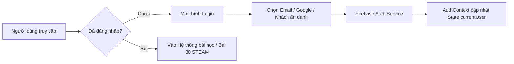
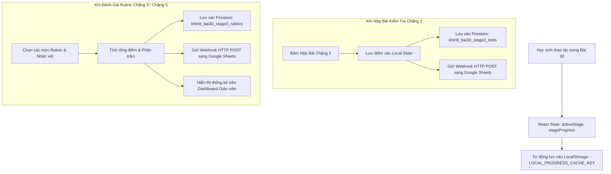

# KIẾN TRÚC HỆ THỐNG (ARCHITECTURE DOCUMENT)
## DỰ ÁN: TÔI YÊU KHOA HỌC TỰ NHIÊN (KHTN 4.0)

---

## 1. CÔNG NGHỆ SỬ DỤNG (TECH STACK)

### 1.1. Frontend Core
- **Framework**: React 19 (`react` & `react-dom` v19.0.0).
- **Ngôn ngữ**: TypeScript 5.8 (`strict: true`).
- **Build Tool / Bundler**: Vite 6 (`vite` v6.2.0) với `@vitejs/plugin-react` và `@tailwindcss/vite`.
- **CSS Engine**: Tailwind CSS v4 (`@tailwindcss/vite` v4.1.14), hỗ trợ Dark/Light Theme và tối ưu hóa CSS Canonical Classes.
- **Routing**: React Router DOM v7 (`react-router-dom` v7.14.2).

### 1.2. Đồ họa, Mô phỏng & Tương tác Khoa học
- **3D Graphics & Physics**: Three.js (`three` v0.184.0), React Three Fiber (`@react-three/fiber`), React Three Drei, Matter.js (vật lý 2D).
- **Mô phỏng Động học Độc lập**: HTML5 Canvas 2D chuyên sâu (`public/thuy-phan-tinh-bot.html`), tích hợp qua `<iframe>` với cơ chế lắng nghe/truyền thông tin an toàn.
- **Animation & Transitions**: Framer Motion (`framer-motion` v12.38.0), Motion (`motion` v12.23.24), GSAP v3.
- **Biểu đồ & Công thức Toán - Hóa**: KaTeX (`katex`, `react-katex`), Recharts v3.
- **Biểu tượng (Icons)**: Lucide React (`lucide-react`), Phosphor Icons (`@phosphor-icons/react`), React Icons (`react-icons`).

### 1.3. Trí tuệ Nhân tạo (AI Engine)
- **Google GenAI SDK**: `@google/genai` v1.29.0 kết nối trực tiếp với các mô hình Gemini (Gemini 2.5 Flash / Gemini Pro).
- Hỗ trợ nhập và lưu trữ Google Gemini API Key bảo mật tại trình duyệt học sinh hoặc giáo viên qua `ApiKeyModal`.

### 1.4. Backend, Cơ sở dữ liệu & Đồng bộ Dữ liệu
- **Firebase Platform**:
  - `firebase/auth`: Xác thực danh tính (Đăng nhập Email/Password, Tài khoản Google, Đăng nhập Ẩn danh / Khách tham gia nhanh).
  - `firebase/firestore`: Lưu trữ dữ liệu thời gian thực (Cộng đồng `community_posts`, Kết quả kiểm tra trắc nghiệm `khtn9_bai30_stage2_tests`, Đánh giá Rubric `khtn9_bai30_stage3_rubrics`, Bảng xếp hạng `leaderboard`).
  - `firebase/storage`: Lưu trữ file hình ảnh sản phẩm mẫu, poster báo cáo của học sinh.
- **Google Sheets Webhook (Apps Script)**:
  - Cổng Webhook HTTP POST trung gian chuyển tiếp kết quả kiểm tra và đánh giá Rubric từ client sang bảng tính Google Sheets của giáo viên mà không cần backend Node.js phức tạp.
- **Offline / Local Persistence**:
  - `localStorage` quản lý tiến độ học sinh qua phiên bản `LOCAL_PROGRESS_CACHE_KEY = 'khtn9_bai30_progress_v3_state'` chống xung đột cache cũ.

### 1.5. Xử lý Tài liệu & Báo cáo
- **Trích xuất & Biên tập Word**: Mammoth, Docx (`docx` v9.7.1).
- **Xuất ảnh & PDF**: `html2canvas`, `html-to-image`, `jspdf`, `jszip`.
- **Thị giác máy tính (OCR)**: Tesseract.js v7, MediaPipe Vision Task (`@mediapipe/tasks-vision`).

---

## 2. CẤU TRÚC THƯ MỤC DỰ ÁN (DIRECTORY STRUCTURE)

```
c:\Website\tôi-yêu-khoa-học-tự-nhiên\
├── public/                       # Tài nguyên tĩnh độc lập
│   ├── thuy-phan-tinh-bot.html   # Mô phỏng Canvas HTML5 động học phân tử Enzyme Amylase
│   ├── audio/                    # Hiệu ứng âm thanh trò chơi & thí nghiệm
│   └── images/                   # Hình ảnh minh họa, sơ đồ cấu trúc phân tử
├── src/
│   ├── assets/                   # Vector, icon, ảnh nội bộ
│   ├── components/               # Các khối giao diện dùng chung
│   │   ├── games/                # Trò chơi tương tác (StarRace, Đua vịt, Game Hub...)
│   │   ├── layout/               # Header, Sidebar, Footer, Navigation
│   │   ├── simulations/          # Hơn 60 mô phỏng bài học KHTN
│   │   │   ├── TinhBotCelluloseElearning.tsx  # Toàn bộ bài giảng E-Learning Bài 30 KHTN 9
│   │   │   ├── GiaoAnAI.tsx                   # Soạn giáo án tự động với AI
│   │   │   └── ...
│   │   ├── ui/                   # Button, Card, Modal, Input, Badge
│   │   ├── AIAssistant.tsx       # Cửa sổ Trợ lý AI Gemini hỗ trợ học tập
│   │   ├── ApiKeyModal.tsx       # Quản lý khóa API cá nhân
│   │   ├── CommunityPage.tsx     # Diễn đàn trao đổi học tập cộng đồng
│   │   ├── Leaderboard.tsx       # Bảng vinh danh điểm số
│   │   ├── LessonRenderer.tsx    # Bộ điều phối nạp bài học động
│   │   └── Login.tsx             # Giao diện đăng nhập đa phương thức
│   ├── config/
│   │   ├── constants.ts          # Hằng số toàn cục dự án
│   │   └── lessonRegistry.ts     # Danh mục đăng ký bài học & mô phỏng
│   ├── context/
│   │   ├── AuthContext.tsx       # Trạng thái đăng nhập & phân quyền người dùng
│   │   ├── LanguageContext.tsx   # Đa ngôn ngữ (Tiếng Việt / English)
│   │   ├── MultiplayerContext.tsx# Kết nối phòng chơi thời gian thực
│   │   ├── ThemeContext.tsx      # Chuyển đổi Dark / Light mode
│   │   └── UserProgressContext.tsx # Quản lý tiến trình học tập
│   ├── data/
│   │   └── defaultGameQuestions.ts # Ngân hàng câu hỏi mẫu
│   ├── hooks/                    # Custom React Hooks (âm thanh, tour hướng dẫn, phím tắt)
│   ├── layouts/                  # Khung bố cục chính (MainLayout)
│   ├── lib/
│   │   ├── firebase.ts           # Khởi tạo Firebase App, Auth, Firestore, Storage
│   │   ├── gemini.ts             # Cấu hình gọi Google GenAI Client
│   │   └── utils.ts              # Tiện ích nối chuỗi class Tailwind
│   ├── pages/
│   │   ├── HomePage.tsx          # Trang chủ giới thiệu các phân môn KHTN
│   │   ├── CategoryPage.tsx      # Danh mục môn (Hóa, Lý, Sinh, Công nghệ)
│   │   └── SubcategoryPage.tsx   # Danh sách bài học theo khối lớp
│   ├── utils/
│   │   ├── docxEditor.ts         # Tiện ích đọc và sửa file Word
│   │   ├── docxExport.ts         # Xuất kế hoạch bài dạy ra Word
│   │   └── exportOfflineGameHtml.ts # Đóng gói trò chơi chơi offline
│   ├── App.tsx                   # Điều hướng Routes cấp cao & xử lý Fullscreen
│   ├── data.ts                   # CSDL bài học, cây chuyên đề toàn trường
│   ├── index.css                 # Import Tailwind CSS v4 & tùy biến phông chữ
│   └── main.tsx                  # Điểm khởi động ứng dụng React
├── firestore.rules               # Quy tắc bảo mật Firestore (cho phép lưu bài thi & rubric)
├── storage.rules                 # Quy tắc bảo mật Firebase Storage
├── vite.config.ts                # Cấu hình Vite & Server Dev
├── package.json                  # Định nghĩa dependencies và scripts
└── [DOCS: PRD, ARCHITECTURE, DESIGN, RULES, TASKS, PROGRESS].md
```

---

## 3. LUỒNG DỮ LIỆU CHÍNH (DATA FLOWS)

### 3.1. Luồng Xác thực & Phân quyền (Authentication Flow)


### 3.2. Luồng Tiến độ & Đánh giá Bài học E-Learning (E-Learning State & Persistence)


### 3.3. Luồng Giao tiếp Mô phỏng Canvas Độc lập (`thuy-phan-tinh-bot.html`)
1. **Khởi tạo**: `TinhBotCelluloseElearning.tsx` nhúng file mô phỏng thông qua thẻ `<iframe>` với chiều cao tối ưu `h-115` (`460px`).
2. **Tương tác cục bộ**: Động cơ hạt bên trong file Canvas tính toán va chạm phân tử giữa Tinh bột, Nước, và Enzyme Amylase; xử lý nhiệt độ ($37^\circ\text{C}$ - $40^\circ\text{C}$) và pH ($6.8$ - $7.0$) hoàn toàn bằng JavaScript nội bộ trên Canvas, không gây giật lag luồng React chính.
3. **Độc lập và An toàn**: Khi người dùng chuyển chặng, iframe tự động được ngắt và dọn dẹp bộ nhớ đồ họa, không để rò rỉ bộ nhớ (Memory Leak).
